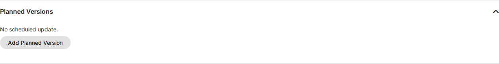
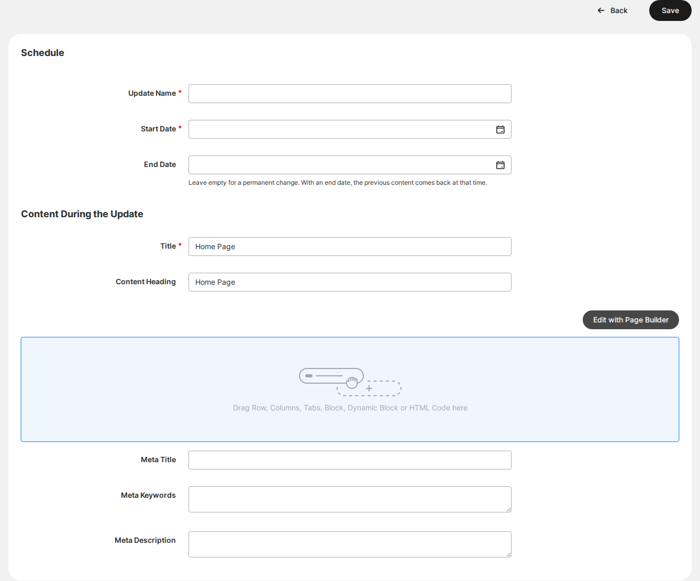
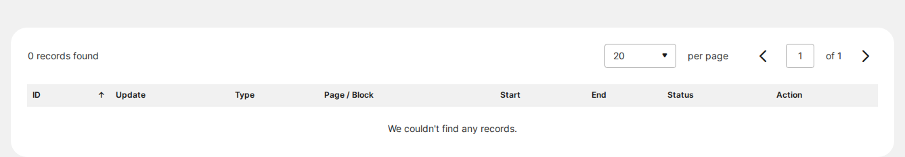

# Content Versions for CMS Pages and Blocks

`mage-os/module-content-versions` (`MageOS_ContentVersions`) — a module for Mage-OS / Magento Open Source.

Schedules temporary or permanent content versions of CMS pages and CMS blocks, with a storefront preview.

- The page and block edit forms get a *Planned Versions* section listing the updates of that content.
- An update has a name, a start date, an optional end date, and the content to show during that period (title and content; for pages also content heading and meta fields). The content field supports Page Builder.
- A cron job runs every minute: at the start date the live content is replaced; at the end date the previous content is restored. Without an end date the change is permanent.
- *Preview* opens the storefront with the scheduled content through a signed link, without changing the live content or the full page cache.
- Two updates of the same content cannot overlap. Editing an active update goes live immediately; deleting it restores the previous content.
- All updates are listed under *Content > Elements > Planned Content Versions*.

Limitations: one update targets a single page or block (no campaigns grouping several contents), and direct edits of the staged fields while an update is active are overwritten when it ends.

## Compatibility

Mage-OS 3.6 and 4.x, and Magento Open Source 2.4.9: all share the Magento 2.4.9 base (`magento/framework` ^103.0.9). PHP 8.3 to 8.5. CI runs the check-extension workflow on the currently supported Mage-OS versions (today Mage-OS 3.6.0 with PHP 8.4; Mage-OS 4.0 joins once the check-extension actions know it); developed on Mage-OS 4.0.0 with PHP 8.5. No storefront templates, so the theme does not matter. Page Builder is supported for the content field.

## Installation

```bash
composer config repositories.mageos-content-versions vcs https://github.com/mage-os-lab/module-content-versions
composer require mage-os/module-content-versions
bin/magento module:enable MageOS_ContentVersions
bin/magento setup:upgrade
```

## Configuration

No configuration. Admin pages:

- *Planned Versions* section on the CMS page and CMS block edit forms.
- *Content > Elements > Planned Content Versions*: all updates.

Viewing updates needs the *Planned Content Versions* ACL resource. Saving or deleting an update also needs the right to save that content: *Save Page* for pages, *Blocks* for blocks.

## Getting started

1. Open a CMS page and go to the *Planned Versions* section.

   

2. Click *Add Planned Version*, give it a name and a start date, optionally an end date, and change the title or content.

   

3. Save, then use *Preview* in the list to see the storefront with that content. The preview link works until the update is finished or deleted.
4. At the start date the cron (every minute) puts the content live; at the end date the previous content comes back.



## Troubleshooting

- **Nothing happens**: Magento cron must run (`bin/magento cron:run` every minute from the system crontab). Check `cron_schedule` for `mageos_content_versions_run`.
- **"You are not allowed to change this content"**: the admin role lacks *Save Page* or *Blocks*.
- **A manual edit was lost**: fields managed by an active update are restored when it ends; edit the update instead.

## More

- [CHANGELOG](CHANGELOG.md)
- [Security policy](SECURITY.md)
- [License](LICENSE.txt): Open Software License 3.0. This module contains no code from Adobe Commerce.
